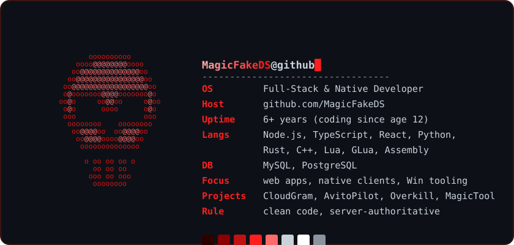

 

<picture>
  <source media="(prefers-color-scheme: light)" srcset="./assets/fetch3-light.svg" />
  <source media="(prefers-color-scheme: dark)" srcset="./assets/fetch3-dark.svg" />
  
</picture>

- **[CloudGram Desktop](https://github.com/MagicFakeDS/cloudgram-desktop)** — нативный мессенджер-клиент на C++/Qt + Microsoft Edge WebView2: E2E-секретные чаты, защита от съёмки экрана, порт сетевого протокола на C++.
- **[AvitoPilot](https://github.com/MagicFakeDS/avito-pilot)** — ИИ-помощник продавца на Авито: Telegram-бот и сайт на Claude анализируют выдачу (цены, конкуренты, продвижение), пишут объявления и подбирают цену. Node.js, grammy, Playwright.
- **[Overkill](https://github.com/MagicFakeDS/overkill)** — мод-песочница разрушения для Minecraft (Fabric, Java): пульт вызывает ядерные удары, метеориты и спутники, управление гравитацией и деформация мира, взрывы и кинематографичные FX. Всё на CC0.
- **[MagicTool](https://github.com/MagicFakeDS/MagicTool)** — утилиты для подготовки и обслуживания Windows-ПК (C++).

<picture>
  <source media="(prefers-color-scheme: light)" srcset="https://github-readme-streak-stats.herokuapp.com?user=MagicFakeDS&hide_border=true&background=ffffff&ring=C01212&fire=C01212&currStreakLabel=C01212&sideLabels=1f2328&dates=656d76&currStreakNum=1f2328&sideNums=1f2328" />
  <source media="(prefers-color-scheme: dark)" srcset="https://github-readme-streak-stats.herokuapp.com?user=MagicFakeDS&hide_border=true&background=0d1117&ring=FF1E1E&fire=FF1E1E&currStreakLabel=FF1E1E&sideLabels=c9d1d9&dates=8b949e&currStreakNum=c9d1d9&sideNums=c9d1d9" />
  
</picture>

